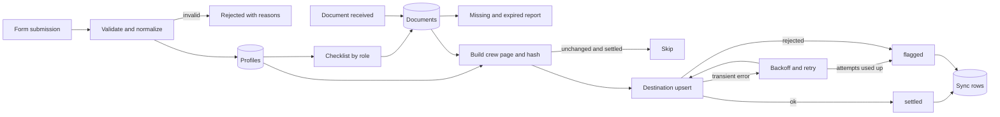

# crew-onboarding-intake

**Know who is cleared to work.** When a contractor brings on a new crew member or subcontractor, someone has to chase the paperwork: insurance certificate, tax form, license, signed agreement. This tool takes the onboarding form, builds the right document checklist for that person's role, and keeps a per person "ready to work: yes or no" page up to date for the office.

For a general contractor, remodeler or property services company that onboards subs and crew through a form and a spreadsheet today.

- A form submission becomes a profile. Sending the form again updates that person, it never creates a duplicate.
- Each role gets its own checklist: a subcontractor owes insurance, a W-9 and a signed agreement, and a licensed trade also owes a license.
- An insurance certificate or license that has passed its expiry date counts as missing again, so a lapsed sub shows as not ready.
- One crew page per person is pushed to an outside system. If that system times out, the push is retried. If it still fails, the row is marked `flagged` instead of being lost, and the next run picks it up.

Built in plain Python with SQLite and no third party runtime dependencies. It runs fully offline: the outside system is a built in mock, and the optional HTTP client has only been tested against a local stub (see [Limitations](#limitations)). All applicants are fake: invented names, example.com emails, 555-01xx phone numbers.

## What you will see

Real lines from `python demo/run_demo.py` (full capture in [`demo/output.txt`](demo/output.txt), and a test fails if that file drifts from what the demo prints):

```
== 3. What is missing (as of 2026-01-15) ==
ID  NAME                ROLE            READY  MISSING
1   Alex Sample         subcontractor   yes    none
2   Casey Example       crew_member     no     emergency_contact, id_verification
3   Jordan Placeholder  licensed_trade  no     insurance_certificate (expired 2026-01-10), signed_agreement

== 4. Sync run 1: destination misbehaves ==
scripted: crew-0002 times out twice, crew-0003 is rejected, crew-0004 never answers
PAGE       STATUS   ACTION   TRIES DETAIL
crew-0001  settled  pushed   1
crew-0002  settled  pushed   3
crew-0003  flagged  failed   1     rejected: mock destination rejected the payload (422)
crew-0004  flagged  failed   4     gave up after 4 attempts: mock destination timed out
```

The failures above are scripted into the mock on purpose, to show the retry and flag paths.

## What it does

- **Intake.** Validates and normalizes a form payload, then creates a profile keyed by email. A resubmission updates the same profile and never duplicates it.
- **Checklist by role.** `crew_member` needs a W-4, ID verification and an emergency contact. `subcontractor` needs an insurance certificate, a W-9 and a signed agreement. `licensed_trade` needs all of that plus a trade license.
- **Missing tracking.** Each item is `missing`, `received` or `expired`. Insurance certificates and licenses must carry an expiry date, and once that date passes the item counts as missing again. If a person's role changes, documents already received stay on file, but only the ones the current role requires count.
- **Sync with retry.** Builds a crew page per profile and upserts it to a destination. Timeouts, rate limits and server errors are retried up to 4 times with exponential backoff (0.5s, 1s, 2s). A rejected payload is not retried. Every row ends as `settled` or `flagged`, and one bad row never blocks the others.
- **Idempotent.** A settled row whose content hash has not changed is skipped. Flagged rows are picked up again on the next run.

## Architecture



| File | Role |
| --- | --- |
| `src/crew_intake/intake.py` | form validation, profile upsert, document receipt, status report |
| `src/crew_intake/checklist.py` | requirements per role and the missing or expired rules |
| `src/crew_intake/store.py` | SQLite tables for profiles, documents and sync rows |
| `src/crew_intake/sync.py` | page building, hashing, retry loop, settled or flagged |
| `src/crew_intake/destinations.py` | mock destination (default) and an optional generic HTTP one |
| `src/crew_intake/cli.py` | `submit`, `receive`, `status`, `sync` commands |

## Run it

Python 3.10 or newer. Nothing to install for the demo or the CLI.

```
python demo/run_demo.py
```

The demo runs in memory with fixed dates, so the output is the same every time. It walks through five fake applicants and one rejected submission, documents arriving (one already expired), the missing report, a sync run against a misbehaving mock, a resubmission, and a second run where the unchanged page is skipped and the flagged pages settle.

The CLI keeps its data in a local SQLite file:

```
cd src
python -m crew_intake submit ../demo/sample_forms.json
python -m crew_intake receive 1 insurance_certificate --expires 2027-06-30
python -m crew_intake status
python -m crew_intake sync
```

`sync` pushes to the mock destination, which keeps its pages in `mock_destination.json`, and exits with code 1 if any row ended `flagged`. `.env.example` lists the optional environment variables. The CLI reads them from the environment and does not load a `.env` file itself. With nothing set, everything stays offline.

## Tests

```
pip install -r requirements-dev.txt
pytest -q
```

40 tests cover validation, the checklist per role, resubmission, role changes, expiry, retry and backoff, flagged rows, skipping unchanged rows, the HTTP client against a stub server on 127.0.0.1, a CLI round trip, and a check that `demo/output.txt` matches the demo. CI in `.github/workflows/ci.yml` runs the tests and the demo on Python 3.10 and 3.12.

## Where this pattern runs

This is drawn from systems that run two small service companies day to day, where new crew and subcontractors come in through a form and an office view of who is cleared to work has to stay correct without anyone retyping it. The code here is a clean rewrite of the pattern with invented data.

## Limitations

- The only destination the demo and CLI use by default is a mock that stores pages in memory or a JSON file. Every timeout and rejection you see in the demo is scripted.
- The HTTP destination is a small generic client (`PUT {url}/pages/{key}` with a bearer token). It is tested against a stub server on 127.0.0.1 and has never been run against a live service. It is not an integration with any particular product: pointing this at a real crew list, CRM or sheet means writing an adapter for that API.
- Retries happen inline within one run, with fixed backoff and no jitter. There is no background queue or scheduler, so a flagged row waits until someone runs sync again.
- A page is never removed from the destination. There is no way to offboard or delete a profile.
- No file uploads. A document is recorded as received with a date, and the file itself is out of scope.
- Document requirements are hard coded in `checklist.py` and are examples, not legal or tax guidance.
- Expiry is a pass or fail check on the day of the run. There is no "expiring soon" warning.
- Single process SQLite, no authentication, no web form. The form is a JSON payload, so wiring up a real form tool is not shown.
- Nobody is notified. The missing report is something you run and read, it does not email or text the applicant.
- Profiles are matched by email only, so the same person with two emails becomes two profiles.

License: MIT, see the LICENSE file.
