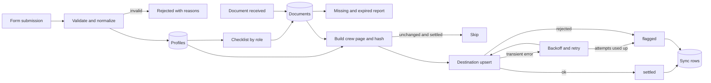

# crew-onboarding-intake

Bringing on a new crew member or subcontractor means chasing paperwork: an insurance certificate, a tax form, a license. Without a system, nobody knows who is cleared to work, and the crew list everyone looks at drifts out of date.

This repo turns a form submission into a profile with a role based document checklist, tracks what is still missing, and syncs one crew page per person to a destination with retry and a final `settled` or `flagged` status per row.

All applicants in this repo are fake. Names, emails (example.com) and phone numbers (555-01xx) are invented.

## What it does

- **Intake.** Validates and normalizes a form payload, then creates a profile keyed by email. A resubmission updates the same profile and never duplicates it.
- **Checklist by role.** `crew_member` needs a W-4, ID verification and an emergency contact. `subcontractor` needs an insurance certificate, a W-9 and a signed agreement. `licensed_trade` needs all of that plus a trade license.
- **Missing tracking.** Each item is `missing`, `received` or `expired`. Insurance certificates and licenses must carry an expiry date, and once that date passes the item counts as missing again.
- **Sync with retry.** Builds a crew page per profile and upserts it to a destination. Timeouts and server errors are retried with exponential backoff. A rejected payload is not retried. Every row ends as `settled` or `flagged`, and one bad row never blocks the others.
- **Idempotent.** A settled row whose content hash has not changed is skipped. Flagged rows are picked up again on the next run.

## Architecture



| File | Role |
| --- | --- |
| `src/crew_intake/intake.py` | form validation, profile upsert, document receipt, status report |
| `src/crew_intake/checklist.py` | requirements per role and the missing or expired rules |
| `src/crew_intake/store.py` | SQLite tables for profiles, documents and sync rows |
| `src/crew_intake/sync.py` | page building, hashing, retry loop, settled or flagged |
| `src/crew_intake/destinations.py` | mock destination (default) and an optional HTTP one |
| `src/crew_intake/cli.py` | `submit`, `receive`, `status`, `sync` commands |

## Run it

Python 3.10 or newer. The runtime has no third party dependencies.

```
python demo/run_demo.py
```

To use the CLI against a local SQLite file (put a form like the ones in `demo/run_demo.py` in a JSON file first):

```
cd src
python -m crew_intake submit ../forms.json
python -m crew_intake status
```

`python -m crew_intake sync` then pushes to the mock destination, which keeps its pages in `mock_destination.json`. Copy `.env.example` to see the optional settings. With nothing set, everything stays offline.

## Tests

```
pip install -r requirements-dev.txt
pytest -q
```

25 tests cover validation, the checklist per role, resubmission, role changes, expiry, retry and backoff, flagged rows, skipping unchanged rows, and a CLI round trip. CI in `.github/workflows/ci.yml` runs the tests and the demo.

## Demo

`python demo/run_demo.py` runs in memory with fixed dates, so the output is the same every time. The captured output is in [`demo/output.txt`](demo/output.txt). It shows:

1. Five fake applicants accepted and one bad submission rejected with every reason listed.
2. Documents arriving, including an insurance certificate that has already expired.
3. The missing report.
4. A sync run where the mock destination times out twice for one page (settles on the third try), rejects another (flagged at once) and never answers for a third (flagged after four tries).
5. A second run where the unchanged page is skipped and the flagged pages settle.

## Where this pattern runs

This is drawn from systems that run two small service companies day to day, where new crew and subcontractors come in through a form and an office view of who is cleared to work has to stay correct without anyone retyping it. The code here is a clean rewrite of the pattern with invented data.

## Limitations

- The HTTP destination is a small generic client that has not been run against any real service. Only the mock destination is exercised by the tests and the demo.
- Retries happen inline within one run. There is no background queue or scheduler, so a flagged row waits until someone runs sync again.
- No file uploads. A document is recorded as received with a date, and the file itself is out of scope.
- Document requirements are hard coded in `checklist.py` and are examples, not legal or tax guidance.
- Expiry is a pass or fail check on the day of the run. There is no "expiring soon" warning.
- Single process SQLite, no authentication, no web form. The form is a JSON payload.
- Profiles are matched by email only, so the same person with two emails becomes two profiles.

License: MIT, see the LICENSE file.
